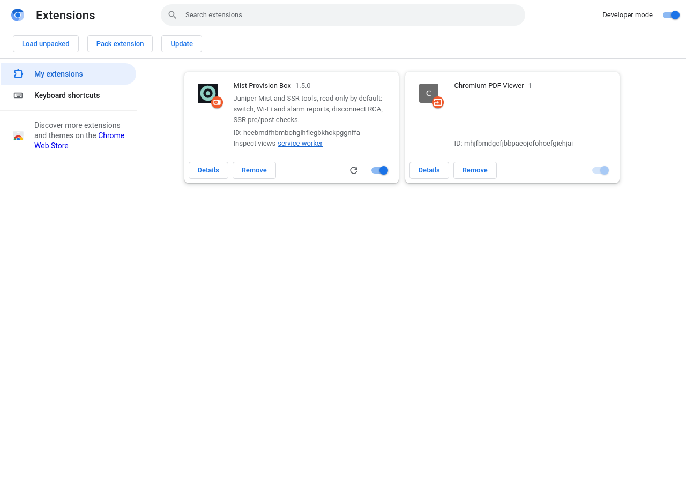

# Installing Mist Provision Box

Mist Provision Box is the write-enabled edition of Mist Toolbox: the same read-only reports, plus
support for tools that make changes to Mist (labelled, warned about and confirmed before they
run). It is a browser extension for **Google Chrome** and **Microsoft Edge**, on Windows,
macOS or Linux. Nothing else needs to be installed: no Python and no server. It is loaded as an
*unpacked* extension straight from a folder on your computer.

> **Safari is not supported.** Safari only runs extensions packaged as a signed Mac app.

## 1. Get the release ZIP

Download **[`mist-provision-box.zip`](https://github.com/InterconnectedSystems/mist-provision-box-public/releases/latest/download/mist-provision-box.zip)** (the latest release) from the
[Releases page](https://github.com/InterconnectedSystems/mist-provision-box-public/releases/latest), or
with the GitHub CLI:

```bash
gh release download -R InterconnectedSystems/mist-provision-box-public -p mist-provision-box.zip
```

To build it yourself from a clone: `mist-toolbox/scripts/build-release.sh`.

It contains just the extension, ready to load. Unzip it somewhere you will keep, for example
`Documents/mist-provision-box`. You get a folder called **`mist-provision-box`** with
`manifest.json` inside. That folder is what you load in step 2.

<details>
<summary>Other ways to get it (for developers)</summary>

- **git:** `git clone https://github.com/InterconnectedSystems/mist-provision-box-public.git`, then
  load the `mist-toolbox` folder inside the clone.

</details>

> **Alongside Mist Toolbox.** It can be loaded next to the read-only Mist Toolbox: each is its own
> folder, and the names in the toolbar (**Mist Provision Box** / **Mist Toolbox**) tell them apart.

> Keep that folder where it is. The browser runs the extension from it, so if the folder is
> moved or deleted, the extension stops working.

## 2. Load it into the browser

| | Chrome | Edge |
|---|---|---|
| Open | `chrome://extensions` | `edge://extensions` |
| Turn on | **Developer mode** (top right) | **Developer mode** (left sidebar) |
| Click | **Load unpacked** | **Load unpacked** |
| Select | the `mist-provision-box` folder | the `mist-provision-box` folder |

Then pin it: click the puzzle-piece icon in the toolbar → pin **Mist Provision Box**.



## 3. First use

1. Click the Mist Provision Box icon. The toolbox opens in its own tab.
2. Pick your **Mist region** (the cloud your portal URL is on, e.g. `manage.gc2.mist.com` → *Global 04*).
3. Paste an **API token** and press **Validate token**. A read-only **Observer** token is
   recommended, and is all every read-only tool needs. Use a token that can make changes only
   when you are about to run a tool that makes changes, such as Switch Site Upgrade or AP Site
   Upgrade to schedule or cancel an upgrade. Create one in the Mist portal under your
   account's profile (*My Profile → API Token → Create Token*). Once validated, the badge next to
   the Organization picker shows what the token may do in that org.
4. Choose the **Organization**, then any tool.


The token is held in that tab's memory only. It is never saved and never given to a tool, and it
is wiped after 30 minutes idle or when you press **End session**. The page's security policy
lets nothing on it reach any host except the Mist regions in the region list.

The **SSR Pre/Post Check** opens in its own tab and does not use the Mist token. It asks for your SSR Conductor's URL,
username and password. The first time you connect, the browser asks permission to reach that
one Conductor. If the Conductor uses a self-signed certificate, the tool links you to open it
in a tab and accept the certificate once.

## Updating

- **Release ZIP:** download the latest `mist-provision-box.zip` (step 1), replace the files in your
  `mist-provision-box` folder with the new ones, then press the **reload** arrow on the extension's
  card in `chrome://extensions`. Your token and settings are never stored, so nothing else
  needs redoing.
- **git:** `git pull`, then press **reload**.

> Tools you added yourself live in the folder's `tools/`. Copy them somewhere safe before
> replacing the folder, and add them back with **Manage tools** afterwards. A `git pull` keeps
> them.

## Troubleshooting

| What you see | What to do |
|---|---|
| **Load unpacked** is missing | Turn on **Developer mode** first. |
| "Manifest file is missing or unreadable" | You picked the wrong folder. Pick the unzipped `mist-provision-box` folder, the one that contains `manifest.json`. If unzipping made a folder inside a folder, go one level down. |
| Chrome warns about developer-mode extensions at startup | Expected for unpacked extensions. Choose to keep it. |
| Extensions are blocked by your organisation | A managed browser can forbid unpacked extensions; ask your IT team. |
| macOS asks whether Chrome may access a folder | Allow it. This appears when **Manage tools** writes into a folder under Desktop, Documents or Downloads. |
| "Validate a Mist token first" / 401 | The token is wrong, expired, or for another region. Check the region drop-down. |
| A tool card says it did not load | Open **Manage tools** and **Remove** it, or fix the file and reload the extension. |

Next: [add your own tools with an AI assistant](ADDING_TOOLS.md).
